# Adult Census Income Analysis and Prediction Using Exploratory Data Analysis and Deep Learning

<p align="center">
  
  
  
  
  
</p>

An end-to-end Machine Learning, Exploratory Data Analysis (EDA), and Deep Learning pipeline investigating socio-economic, educational, and occupational determinants of annual income ($>50\text{K}$ vs. $\le 50\text{K}$) using the authentic 1994 U.S. Census Bureau dataset from Kaggle.

---

## Table of Contents
1. [Project Overview & Objectives](#1-project-overview--objectives)
2. [Dataset Information & Acquisition](#2-dataset-information--acquisition)
3. [Technology Stack](#3-technology-stack)
4. [Repository & Directory Structure](#4-repository--directory-structure)
5. [Installation & Setup](#5-installation--setup)
6. [Execution Instructions](#6-execution-instructions)
7. [Data Cleaning & Leak-Free Preprocessing](#7-data-cleaning--leak-free-preprocessing)
8. [The Seven Stages of Visualization](#8-the-seven-stages-of-visualization)
9. [Exploratory Data Analysis (Visualizations)](#9-exploratory-data-analysis-visualizations)
10. [Deep Learning Architecture & Tuning](#10-deep-learning-architecture--tuning)
11. [Held-Out Test Set Evaluation](#11-held-out-test-set-evaluation)
12. [Permutation Feature Importance & Bias Analysis](#12-permutation-feature-importance--bias-analysis)
13. [Steps to Push to GitHub](#13-steps-to-push-to-github)
14. [License](#14-license)

---

## 1. Project Overview & Objectives

The primary objective of this project is to model individual socio-economic census data and construct a binary deep learning classifier to predict income brackets:
- **Class 0 ($\le 50\text{K}$):** Individuals earning $50,000 or less annually (Majority: $\sim 75.9\%$).
- **Class 1 ($> 50\text{K}$):** Individuals earning greater than $50,000 annually (Minority: $\sim 24.1\%$).

### Key Highlights
- **Strict Leakage Prevention:** Stratified $70:15:15$ Train/Val/Test split with all imputers, scalers, and encoders fit strictly on the Training set only.
- **Deep Learning MLP:** Built with TensorFlow/Keras featuring Dropout regularization and Early Stopping.
- **Ben Fry's 7 Stages:** Systematically documented from acquisition to communication.
- **Model-Agnostic Interpretability:** Permutation feature importance and ethical demographic bias analysis.

---

## 2. Dataset Information & Acquisition

- **Dataset Name:** Adult Census Income
- **Kaggle URL:** [https://www.kaggle.com/datasets/uciml/adult-census-income](https://www.kaggle.com/datasets/uciml/adult-census-income)
- **Dataset Identifier:** `uciml/adult-census-income`
- **Raw Dimensions:** $32,561$ rows $\times$ $15$ columns
- **Cleaned Dimensions:** $32,537$ rows $\times$ $15$ columns ($24$ duplicate records dropped)

### Automated Download via Kaggle CLI
```powershell
python -m kaggle datasets download -d uciml/adult-census-income -p data --unzip
```

### Manual Download Instructions
1. Navigate to [Kaggle Adult Census Income](https://www.kaggle.com/datasets/uciml/adult-census-income).
2. Download and extract the archive.
3. Place `adult.csv` inside the `data/` folder.

---

## 3. Technology Stack

- **Language:** Python 3.11
- **Data Manipulation:** `pandas 3.0+`, `NumPy 2.4+`
- **Data Visualization:** `Matplotlib 3.11+`, `Seaborn 0.13+`
- **Machine Learning & Preprocessing:** `scikit-learn 1.9+`
- **Deep Learning Framework:** `TensorFlow 2.21+` / `Keras 3.15+`
- **Notebook Environment:** `Jupyter Notebook`, `nbconvert`, `ipykernel`

---

## 4. Repository & Directory Structure

```text
EDA_Adult_Income_Project/
│
├── data/
│   └── adult.csv                             # Raw Kaggle census dataset (32,561 rows)
│
├── notebooks/
│   └── eda_adult_income.ipynb                # Fully executed Jupyter notebook with outputs
│
├── src/
│   ├── data_loader.py                        # Dataset loading & schema profiling
│   ├── preprocessing.py                      # Leak-free cleaning, imputation & encoding
│   ├── eda_analysis.py                       # Statistical distributions, cross-tabs & correlations
│   ├── visualizations.py                     # High-res visualization generation
│   ├── model_training.py                     # Keras MLP architecture, validation tuning & early stopping
│   └── evaluation.py                         # Test evaluation, 4 eval plots & feature importance
│
├── outputs/
│   ├── figures/                              # High-resolution (300 DPI) exported figures
│   │   ├── viz1_income_distribution.png
│   │   ├── viz2_age_distribution.png
│   │   ├── viz3_education_frequency.png
│   │   ├── viz4_working_hours_by_income.png
│   │   ├── viz5_education_income_relationship.png
│   │   ├── viz6_correlation_heatmap.png
│   │   ├── viz7_capital_gain_loss_by_income.png
│   │   ├── viz8_occupation_income.png
│   │   ├── eval1_loss_epochs.png
│   │   ├── eval2_accuracy_epochs.png
│   │   ├── eval3_confusion_matrix.png
│   │   ├── eval4_roc_curve.png
│   │   └── eval5_feature_importance.png
│   │
│   ├── metrics/                              # CSV and JSON summary tables
│   │   ├── dataset_summary.json
│   │   ├── numerical_summary.csv
│   │   ├── categorical_summary.csv
│   │   ├── missing_values_summary.csv
│   │   ├── outlier_summary.csv
│   │   ├── correlation_matrix.csv
│   │   ├── hyperparameter_tuning_results.csv
│   │   ├── training_history.json
│   │   ├── test_classification_report.csv
│   │   ├── model_evaluation_metrics.json
│   │   ├── feature_importance.csv
│   │   └── income_proportions_*.csv
│   │
│   └── processed/                            # Preprocessing metadata & .gitkeep
│       └── preprocessor_metadata.json
│
├── models/
│   └── mlp_income_model.keras                # Saved Keras deep learning model artifact
│
├── main.py                                   # Master end-to-end execution script (auto-venv aware)
├── requirements.txt                          # Project dependency specifications
├── .gitignore                                # Comprehensive GitHub exclusions
├── LICENSE                                   # MIT Open-Source License
└── README.md                                 # Complete documentation
```

---

## 5. Installation & Setup

Clone the repository and enter the project folder:

```powershell
git clone https://github.com/<YOUR-USERNAME>/EDA_Adult_Income_Project.git
cd EDA_Adult_Income_Project
```

### 1. Create and Activate Virtual Environment
```powershell
python -m venv .venv
.\.venv\Scripts\Activate.ps1
```

### 2. Install Dependencies
```powershell
python -m pip install --upgrade pip
python -m pip install -r requirements.txt
```

---

## 6. Execution Instructions

### Run the Master Pipeline
Execute all steps (loading, EDA, figures, leak-free preprocessing, validation tuning, deep learning training, test set evaluation, and permutation feature importance) in one command:
```powershell
python main.py
```
*(Note: `main.py` contains auto-virtual-environment detection so it executes reliably whether invoked with active `.venv` or standard `python`.)*

### Run / Re-execute Jupyter Notebook End-to-End
```powershell
python -m nbconvert --to notebook --execute --inplace notebooks/eda_adult_income.ipynb
```

---

## 7. Data Cleaning & Leak-Free Preprocessing

1. **Missing Value Standardization:** Converted `'?'` placeholders in `workclass` ($1,836$), `occupation` ($1,843$), and `native.country` ($583$) to `np.nan`.
2. **Whitespace Stripping:** Trimmed leading and trailing whitespaces across all string features.
3. **Duplicate Handling:** Detected and dropped $24$ duplicate rows ($32,561 \rightarrow 32,537$).
4. **Stratified Splitting ($70:15:15$):**
   - **Train Set:** $22,775$ rows ($70.0\%$, Positive Rate: $24.09\%$)
   - **Validation Set:** $4,881$ rows ($15.0\%$, Positive Rate: $24.09\%$)
   - **Test Set:** $4,881$ rows ($15.0\%$, Positive Rate: $24.09\%$)
5. **Leakage Prevention:**
   - Numerical `SimpleImputer(strategy='median')` and `StandardScaler` were fit strictly on the Training set.
   - Categorical `SimpleImputer(strategy='most_frequent')` and `OneHotEncoder(handle_unknown='ignore')` were fit strictly on the Training set.
   - Output feature vector: **$104$ dimensions**.

---

## 8. The Seven Stages of Visualization

| Stage | Implementation Details | Script Reference |
| :--- | :--- | :--- |
| **1. Acquire** | Automated retrieval of Kaggle `adult.csv` via Kaggle API. | `src/data_loader.py` |
| **2. Parse** | Schema parsing, data type cast, identifying `?` sentinels. | `src/data_loader.py` |
| **3. Filter** | Deduplication ($24$ rows dropped), trimming whitespace, isolating nulls. | `src/preprocessing.py` |
| **4. Mine** | Computing IQR outlier thresholds, skewness, Pearson correlation matrix. | `src/eda_analysis.py` |
| **5. Represent** | Choosing suitable encodings (bar charts, boxplots, histograms, heatmaps). | `src/visualizations.py` |
| **6. Refine** | Applying custom color palettes, direct data annotations, exporting at 300 DPI. | `src/visualizations.py` |
| **7. Interact / Communicate** | Interpreting class imbalance, non-linear patterns, and demographic limitations. | `notebooks/eda_adult_income.ipynb` |

---

## 9. Exploratory Data Analysis (Visualizations)

### Target Class Distribution & Age Profile
<p align="center">
  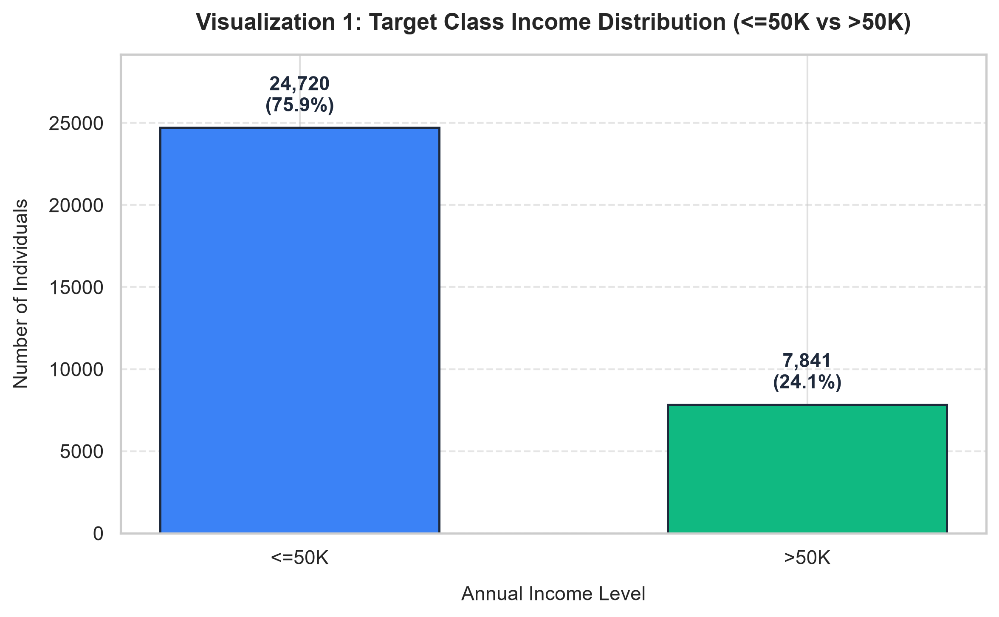
  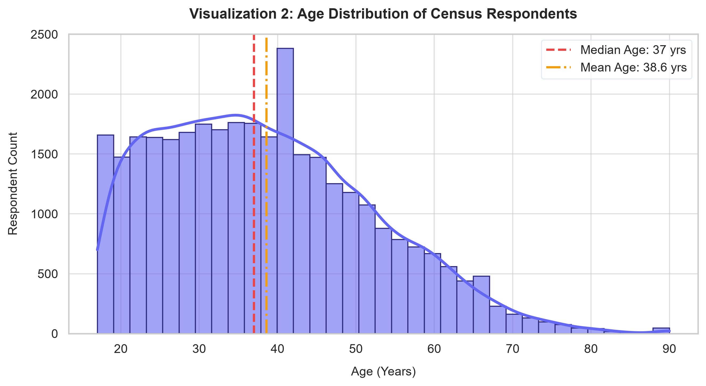
</p>

- **Viz 1 (Income Distribution):** Illustrates the $75.9\% : 24.1\%$ imbalance between $\le 50\text{K}$ ($24,698$) and $>50\text{K}$ ($7,839$) earners, establishing why accuracy must be supplemented by precision, recall, and F1-score.
- **Viz 2 (Age Distribution):** Highlights right-skewness (Median: $37$ yrs, Mean: $38.6$ yrs) with primary workforce density concentrated between $25$ and $45$ years of age.

---

### Education & Working Hours
<p align="center">
  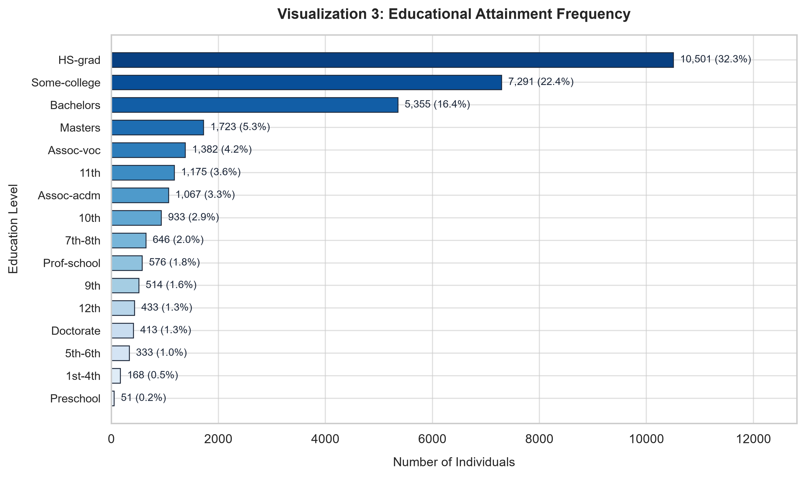
  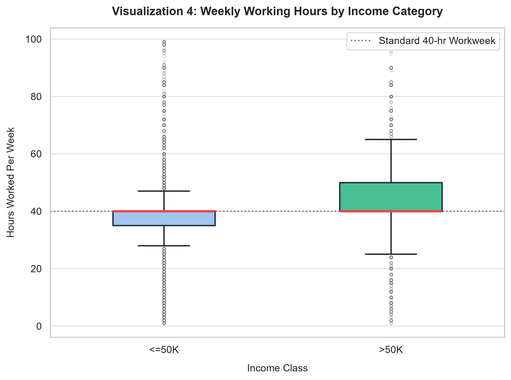
</p>

- **Viz 3 (Education Attainment):** Identifies `HS-grad` ($10,494$, $32.3\%$), `Some-college` ($7,282$, $22.4\%$), and `Bachelors` ($5,353$, $16.5\%$) as the three dominant education categories.
- **Viz 4 (Working Hours by Income):** While both groups share a median of $40$ hrs/week, high earners ($>50\text{K}$) exhibit a wider upper quartile ($45\text{--}50$ hrs/week) and significantly higher overtime propensity.

---

### Education-Income Relationship & Numerical Correlations
<p align="center">
  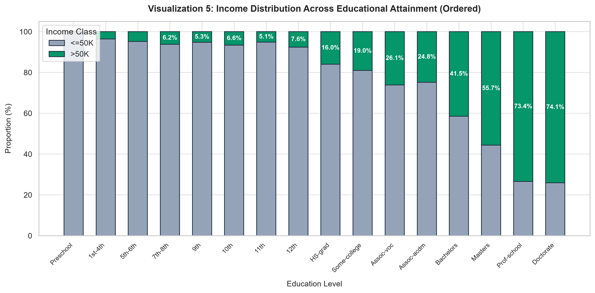
  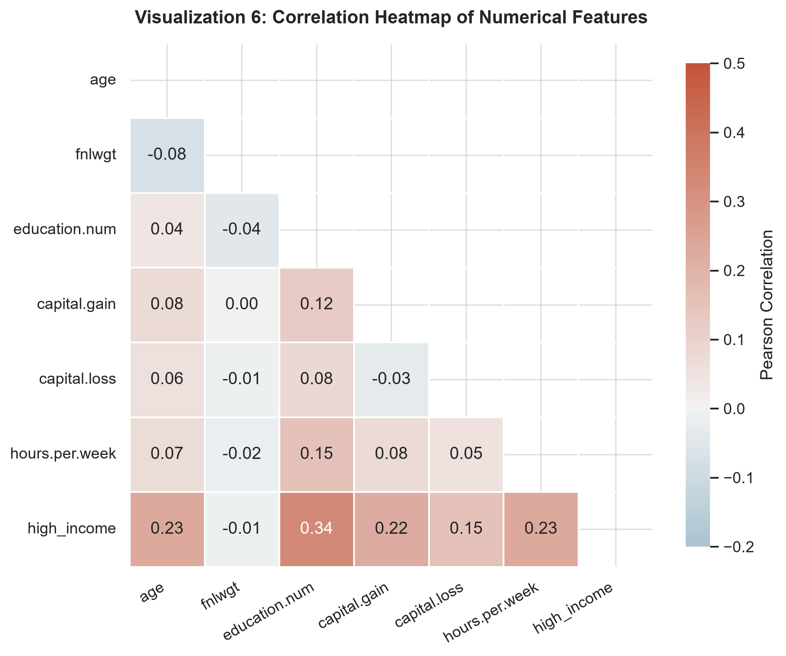
</p>

- **Viz 5 (Education vs. Income):** 100% stacked bar chart revealing a strong monotonic increase in high-income proportions with educational level (Doctorate $>70\%$, Masters $>55\%$, Bachelors $\sim 41\%$, HS-grad $\sim 16\%$).
- **Viz 6 (Correlation Heatmap):** Pearson correlation reveals moderate associations with target income for `education.num` ($+0.34$), `age` ($+0.23$), and `hours.per.week` ($+0.23$).

---

### Supplementary Domain Plots
<p align="center">
  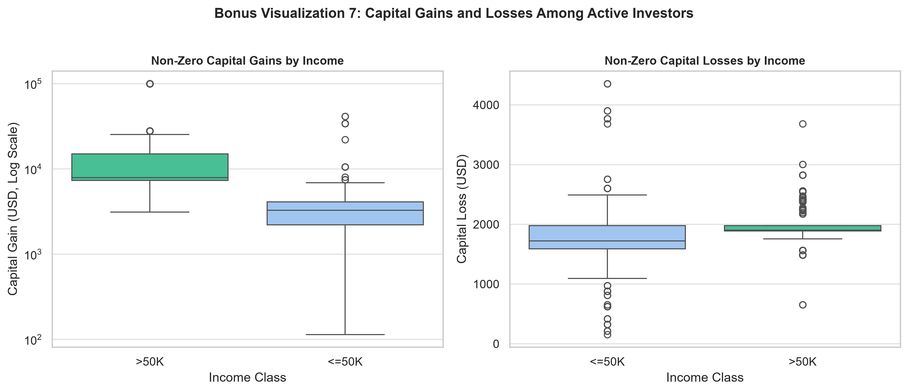
  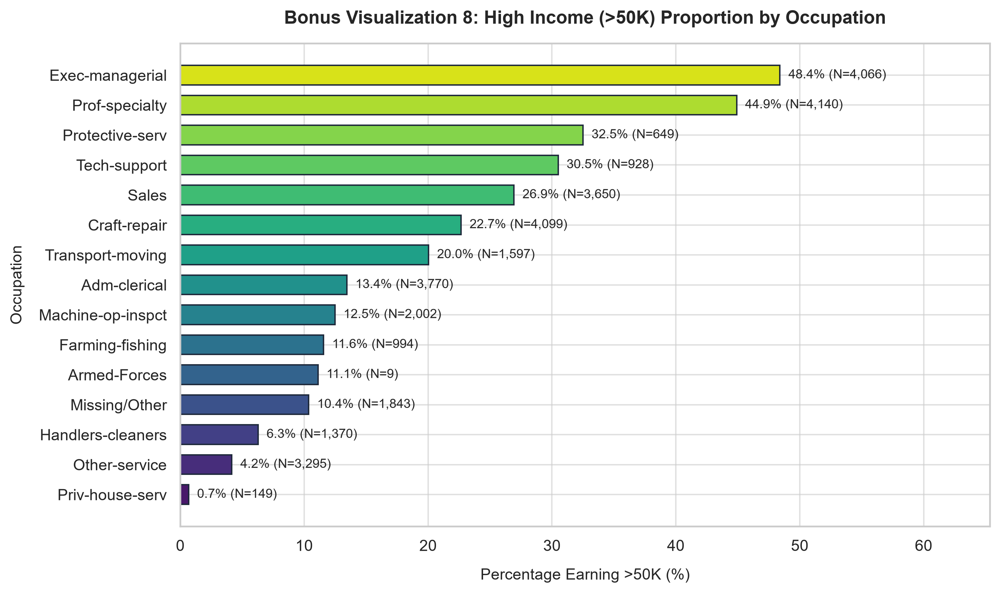
</p>

- **Bonus Viz 7 (Capital Gains & Losses):** Depicts extreme zero-inflation in investments; high earners dominate substantial capital gain percentiles.
- **Bonus Viz 8 (Occupation Breakdown):** Top earning sectors include `Exec-managerial` ($48.4\%$) and `Prof-specialty` ($44.9\%$), contrasting with `Priv-house-serv` ($0.7\%$) and `Other-service` ($4.2\%$).

---

## 10. Deep Learning Architecture & Tuning

### Architecture Diagram
```text
Input Features (104)
        │
        ▼
Dense (128 Neurons, ReLU)
        │
        ▼
Dropout (Rate = 0.30)
        │
        ▼
Dense (64 Neurons, ReLU)
        │
        ▼
Dropout (Rate = 0.20)
        │
        ▼
Output Dense (1 Neuron, Sigmoid)  ──►  P(Income > 50K)
```

### Validation Hyperparameter Comparison
| Configuration | Units | Dropout | Learning Rate | Best Epoch | Val Loss | Val Accuracy | Val AUC |
| :--- | :---: | :---: | :---: | :---: | :---: | :---: | :---: |
| **Config 1 (Baseline)** | `[128, 64]` | `[0.30, 0.20]` | $0.001$ | 5 | **0.3159** | **0.8511** | **0.9089** |
| **Config 2 (Compact)** | `[64, 32]` | `[0.20, 0.10]` | $0.001$ | 5 | 0.3182 | 0.8504 | 0.9079 |
| **Config 3 (Wider)** | `[256, 128]` | `[0.35, 0.25]` | $0.0005$ | 6 | 0.3168 | 0.8502 | 0.9082 |

---

## 11. Held-Out Test Set Evaluation

Evaluated strictly on the held-out test partition ($4,881$ samples):

### Performance Metrics Summary
- **Test Set Accuracy:** **$85.27\%$**
- **Area Under ROC Curve (ROC-AUC):** **$0.9081$**
- **Macro-Averaged F1-Score:** **$0.7911$**
- **Weighted-Averaged F1-Score:** **$0.8500$**
- **Specificity (True Negative Rate):** **$91.93\%$**

### Classification Report
| Class | Precision | Recall | F1-Score | Support |
| :--- | :---: | :---: | :---: | :---: |
| **$\le 50\text{K}$ (0)** | **0.8902** | **0.9193** | **0.9045** | 3,705 |
| **$> 50\text{K}$ (1)** | **0.7166** | **0.6429** | **0.6777** | 1,176 |

### Evaluation Visualizations
<p align="center">
  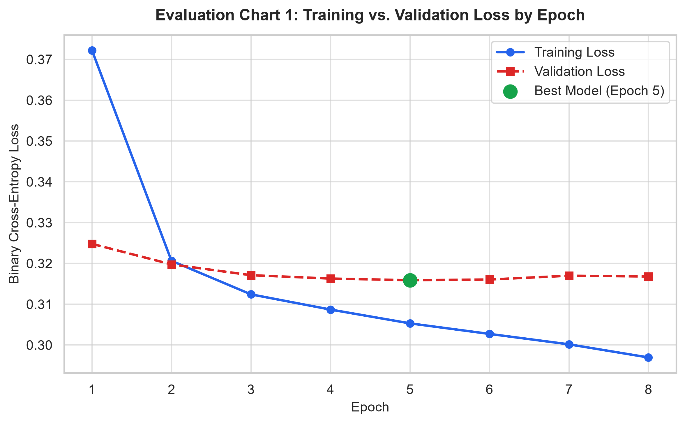
  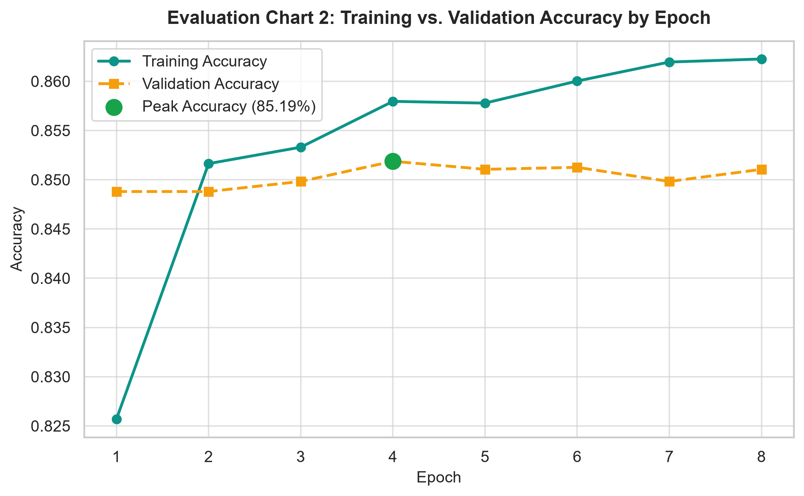
</p>
<p align="center">
  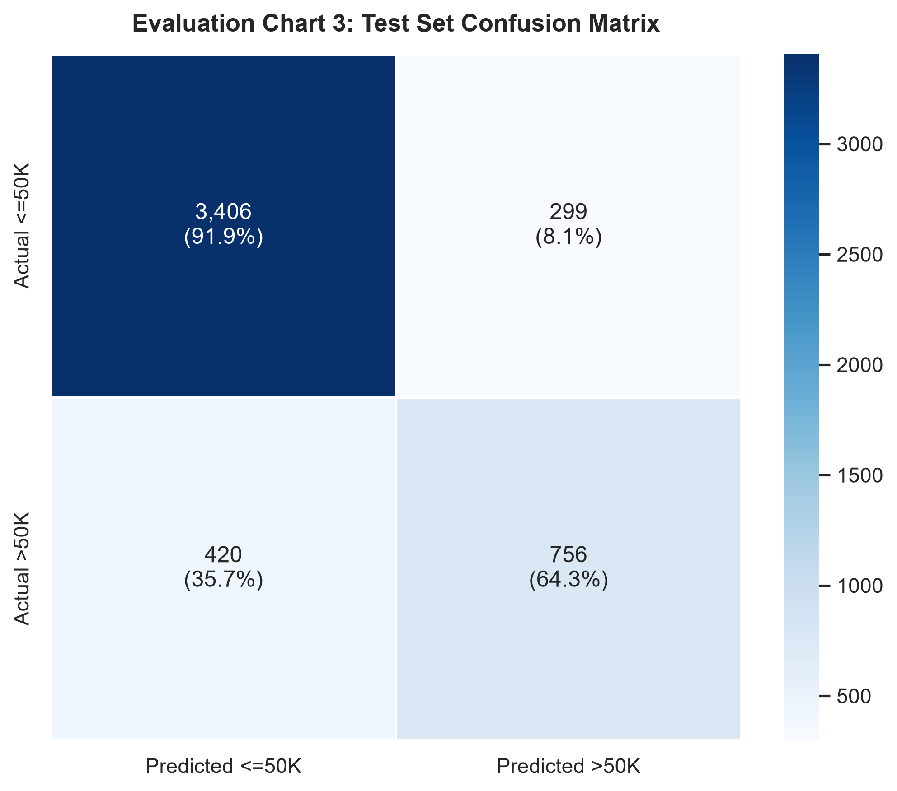
  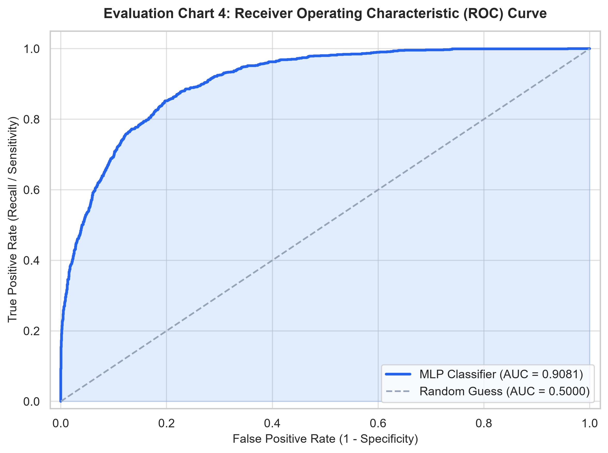
</p>

---

## 12. Permutation Feature Importance & Bias Analysis

<p align="center">
  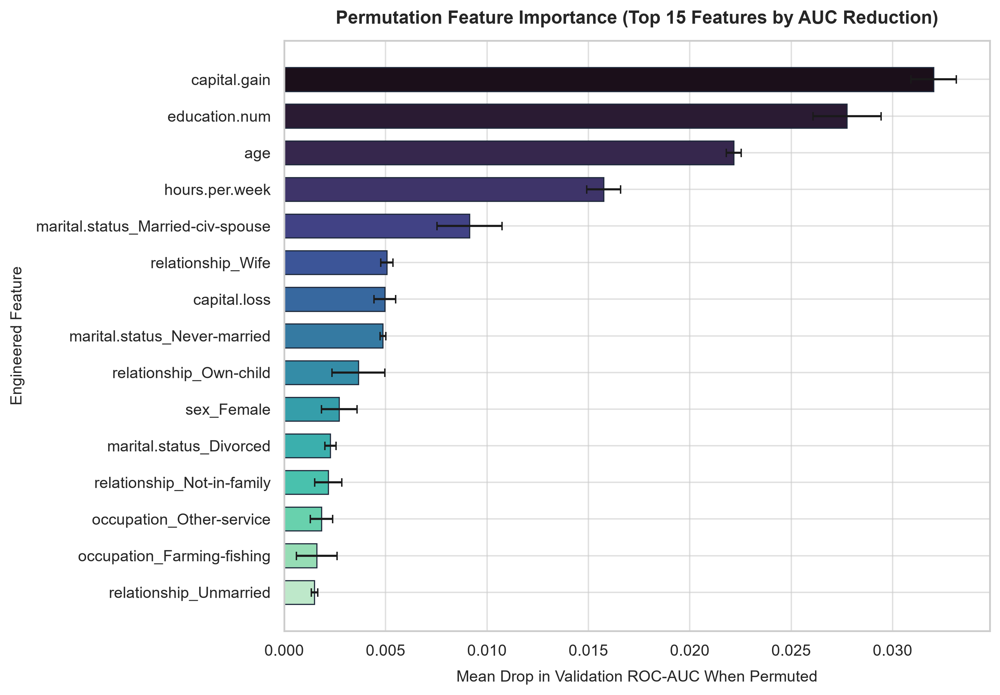
</p>

### Key Predictors
1. `capital.gain`: Strongest single predictor of exceeding $\$50\text{K}$.
2. `marital.status_Married-civ-spouse` & `relationship_Husband`: Primary socio-economic indicators.
3. `education.num`: Continuous metric of educational investment.
4. `age`: Career maturity and tenure.
5. `hours.per.week`: Direct measure of labor supply.

### Demographic Bias & Ethical Considerations
- **Non-Causality:** Statistical importance reflects observational correlations in cross-sectional survey data, not causal levers.
- **Historical Inequities:** The 1994 Census reflects historical workforce disparities across gender and racial classifications.
- **Algorithmic Fairness:** Uncritical deployment of demographic variables in credit, lending, or employment algorithms can automate and amplify historical disadvantages.

---

## 13. Steps to Push to GitHub

To push this repository to GitHub, run the following commands inside PowerShell:

```powershell
# 1. Ensure you are in the project folder
cd d:\Documents\Academics\EDA\Ass_2\EDA_Adult_Income_Project

# 2. Initialize a Git repository
git init

# 3. Add all project files
git add .

# 4. Create your initial commit
git commit -m "feat: complete Adult Census Income EDA and Deep Learning project"

# 5. Rename branch to main
git branch -M main

# 6. Add your GitHub remote repository (replace with your repository URL)
git remote add origin https://github.com/<YOUR-USERNAME>/<YOUR-REPO-NAME>.git

# 7. Push to GitHub
git push -u origin main
```

---

## 14. License

Distributed under the [MIT License](LICENSE).
